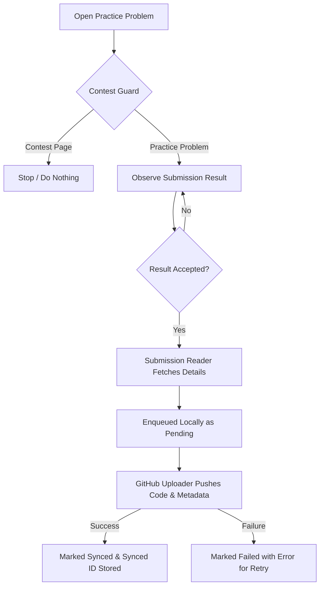

# LeetCode to GitHub Backup Extension

A lightweight, secure Chrome extension that automatically backs up **your own accepted LeetCode practice solutions and metadata** directly to your GitHub repository. It operates 100% locally within your browser, communicates with no third-party backends, and strictly guards against running on contest pages.

---

## Features

- ⚡ **Automatic Background Sync**: Watches practice submissions in real-time and backs up solutions as soon as they receive an **Accepted** verdict.
- 🛡️ **Contest Guard**: Contest pages (`/contest/`) are strictly excluded by default so the extension never interferes with live competitions.
- 🗄️ **Local Queue & Deduplication**: Every accepted submission is recorded in Chrome local storage before upload. Submissions are tracked by unique submission ID to prevent redundant commits or duplicate files.
- 🔄 **Safe Retry Engine**: Retries failed uploads using SHA-aware GitHub REST API calls, avoiding git conflicts and ensuring zero lost submissions.
- ⏳ **Historical Backfill**: Manually scan your signed-in LeetCode account's past accepted submissions, review what needs backing up, and backfill them gradually with resume capability.
- 🔒 **Zero-Trust Privacy & Minimal Permissions**: No telemetry, no third-party servers, and no cookie exfiltration. Uses a fine-grained GitHub token restricted solely to your chosen backup repository.

---

## Repository Structure

```text
leetcode-backup/
├── manifest.json
├── src/
│   ├── content.js
│   ├── contest-guard.js
│   ├── submission-reader.js
│   ├── queue.js
│   ├── github-uploader.js
│   └── popup/
│       ├── popup.html
│       ├── popup.js
│       └── settings.js
├── styles/
│   └── popup.css
├── icons/
│   ├── icon-16.png
│   ├── icon-32.png
│   ├── icon-48.png
│   └── icon-128.png
├── README.md
└── LICENSE
```

---

## Data Saved Per Submission

Each accepted submission is saved in a standardized folder structure using the 4-digit zero-padded problem number and slug:

```text
problems/
└── 0001-two-sum/
    ├── solution.py
    └── metadata.json
```

### Example `metadata.json`

```json
{
  "submission_id": "123456789",
  "problem_id": "1",
  "frontend_id": "1",
  "problem_title": "Two Sum",
  "problem_slug": "two-sum",
  "language": "python3",
  "timestamp": 1728663414,
  "submitted_at": "2026-10-11T16:16:54.000Z",
  "result": "Accepted",
  "runtime": "38 ms",
  "runtime_percentile": "88.4%",
  "memory": "16.5 MB",
  "memory_percentile": "76.2%",
  "problem_url": "https://leetcode.com/problems/two-sum/"
}
```

---

## Installation

1. Clone or download this repository.
2. Open Google Chrome and navigate to `chrome://extensions/`.
3. Enable **Developer mode** using the toggle in the upper-right corner.
4. Click **Load unpacked** in the top-left toolbar.
5. Select this project root folder (containing `manifest.json`).
6. Pin the extension icon to your Chrome toolbar for easy access.

---

## Setup & Configuration

### 1. Create a Fine-Grained GitHub Token

To follow the principle of least privilege:

1. Go to GitHub → **Settings** → **Developer settings** → **Personal access tokens** → **Fine-grained tokens** (or visit [https://github.com/settings/tokens?type=beta](https://github.com/settings/tokens?type=beta)).
2. Click **Generate new token**.
3. Set a name (e.g., `LeetCode Backup Extension`).
4. Under **Repository access**, select **Only select repositories** and pick your designated backup repository.
5. Under **Permissions**, expand **Repository permissions** and set:
   - **Contents**: `Read and write` (all other permissions can remain `None`).
6. Click **Generate token** and copy your token.

### 2. Configure Extension Settings

1. Click the extension icon in your Chrome toolbar.
2. Switch to the **Settings** tab.
3. Fill in:
   - **GitHub Personal Access Token**: Paste your token.
   - **Repository Owner**: Your GitHub username or organization name.
   - **Repository Name**: The name of your backup repository (e.g. `leetcode-solutions`).
   - **Target Branch**: Branch to commit to (default: `main`).
   - **Sync Contest Submissions**: Leave unchecked (default).
4. Click **Test GitHub Connection** to verify that your token and repository permissions are valid.
5. Click **Save Settings**.

---

## How It Works

### 1. New Submission Flow



1. You open a regular LeetCode practice problem.
2. The **Contest Guard** checks the URL. If it detects a contest page, it exits immediately and attaches no listeners.
3. When you submit your code, the DOM observer monitors for the **Accepted** verdict.
4. The **Submission Reader** queries LeetCode's authenticated endpoint for the submission ID, code, language, runtime, memory, and question metadata.
5. The submission is queued in `chrome.storage.local` with status `pending`.
6. The **GitHub Uploader** writes `problems/0001-two-sum/solution.<ext>` and `metadata.json` via the GitHub REST API.
7. Upon successful GitHub response, the status updates to `synced`. If the network fails, the item remains `pending` or `failed` for automatic or manual retry.

### 2. Historical Backfill Flow

1. Open the extension popup and click the **Backfill** tab.
2. Click **Scan Accepted Submissions**.
3. The extension scans your authenticated submission history, filtering for accepted entries and diffing them against solutions already backed up.
4. Review the count of new submissions found.
5. Click **Start Gradual Backfill**. Submissions are processed with rate-pacing delays to respect API limits.
6. Progress is persisted locally after each submission, allowing backfills to be paused, resumed, or recovered seamlessly after interruptions.

---

## Security & Data Boundaries

- **Local Execution**: All logic runs locally in Chrome; there is no third-party telemetry, proxy, or tracking service.
- **Credential Safety**: Your GitHub token is stored solely in `chrome.storage.local` on your machine and is never transmitted anywhere other than `https://api.github.com`.
- **Zero Cookie Transfer**: LeetCode cookies and session data are never extracted, duplicated, or sent off-device.
- **Isolated Module Design**: LeetCode's undocumented API interactions are isolated in `src/submission-reader.js`, making future maintenance simple if LeetCode updates its UI.

---

## License

This project is licensed under the [MIT License](LICENSE).
